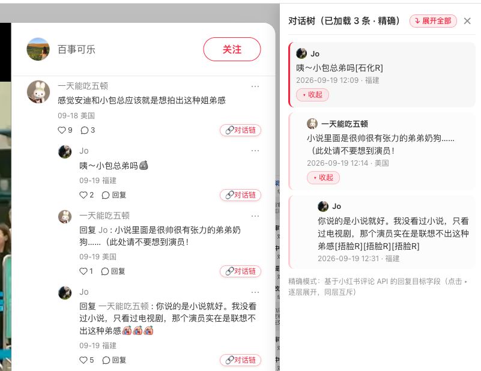

# XHS Thread Tracer（小红书对话链增强）

浏览器扩展（Chrome MV3，兼容 Edge）：还原小红书评论区里一条回复的**完整对话链**——从楼主到你正在看的那条回复，按顺序列出中间每一环，解决「楼中楼压平 + 回复不引用原文 + 官方查看对话只显示两人」导致的上下文丢失问题。



*左侧：每条评论右下角注入「🔗对话链」按钮；右侧：手风琴式对话树面板（逐层展开、同层互斥、点击行跳回原文）。*

## 安装（开发者模式加载）

1. 下载/克隆本目录
2. Chrome 打开 `chrome://extensions/`，右上角开启「开发者模式」
3. 点「加载已解压的扩展程序」，选择本目录（含 `manifest.json`）
4. 打开任意小红书笔记页（需登录网页版），评论旁会出现「🔗对话链」按钮

## 工作原理

双通道解析：

| 模式 | 数据来源 | 可靠性 |
|---|---|---|
| **精确** | MAIN world 脚本旁听 `fetch/XHR` 捕获评论 API 响应（`/api/sns/web/v2/comment/page` 与 `/comment/sub/page`），利用响应里的 `target_comment` 字段精确还原父子关系 | 高 |
| **启发式** | DOM 兜底：解析「回复 @昵称」前缀，在同一主楼容器内按「同昵称 + 时间/DOM 顺序最近」推断父节点 | 中，可能与实际回复目标有出入 |

点击按钮后右侧滑出面板：展示该评论所属**主楼的对话树**，采用**手风琴式逐层展开**——

- 默认只显示**楼主（顶层）**与通往你所点评论的那一条祖先路径，其余分支全部收起
- 每个有回复的节点带「▸ 展开 N 条回复」开关（N 为 API 报告的楼中楼总数；数据未加载完时显示 已加载/总数），点击逐层展开
- **同层互斥**：同一层展开一个分支，之前展开的兄弟分支自动收起，面板始终只呈现一条聚焦路径
- 点「▾ 收起」折叠；点行本体滚动到原文并高亮

**自动展开楼中楼**：无需手动点「展开 N 条回复」——点「🔗对话链」时插件会自动替你点击该楼容器内的展开按钮（点击前自动滚动到按钮位置，页面自己发出带签名的请求，hook 顺手捕获），数据到齐后面板自动刷新，底部显示「已 N/M 条」进度（自动展开只负责**加载数据**，面板内展示仍由你逐层点击控制）。面板右上角还有「⤵ 展开全部」一键加载整页所有楼。防呆设计：轮数封顶 + 自适应等待（数据一到立刻下一轮）+ 无进展检测 + 进度条可点击手动重试；若数据没齐却找不到按钮，控制台会打印 `[xhs-tracer] 展开停滞` 及容器内候选元素，便于按改版调整。

不发任何额外网络请求，只旁听页面自身请求 + 模拟点击页面已有按钮，纯本地处理。

## 调试

- DevTools 控制台：`window.__xhsTracerRaw`（MAIN world，最近 30 条原始 API 响应）
- DevTools 控制台（切到 top frame 默认上下文不可见时，在 Console 面板左上角下拉里选扩展的 isolated context）：`__xhsTracer.store`（已归一化的评论数据）、`__xhsTracer.rescan()`

## 小红书改版后怎么办（选择器调参）

DOM 兜底依赖 `content.js` 顶部的 `SELECTORS`（已按 2026-10 真实页面 DOM 校准）：

```js
const SELECTORS = {
  commentItem: '.comment-item',                              // 楼中楼为 .comment-item.comment-item-sub
  authorName: '.author a.name, a.name, .author .name',
  content: '.content .note-text, .note-text, .content'
};
const COMMENT_ID_RE = /^comment-([0-9a-f]+)$/;               // 真实节点自带 id="comment-{评论id}"
```

若按钮不出现或提取错内容：在评论元素上右键「检查」，对照更新即可。精确模式主要依赖 API hook + 节点 `id="comment-{id}"`，对改版相对鲁棒。

## 本地测试

```bash
# 核心逻辑冒烟测试（Node，无浏览器依赖）
node test/run_test.mjs

# UI 预览：浏览器直接打开 test/mock_page.html（模拟评论区 DOM）
```

## 已知限制

- 首次进入笔记页前已加载的评论若走的是 SSR（无 API 请求），需滚动触发分页后精确模式才有数据；期间按钮走 DOM 启发式
- 昵称重名的楼中楼在启发式模式下可能挂错父节点（精确模式无此问题）
- 未展开的折叠楼中楼不在 DOM 里，需点开「展开 N 条回复」后再使用
- 移动端网页 / App 不适用

## Roadmap

- [ ] 楼中楼一键「按时间排序」视图
- [ ] 悬浮 @昵称时高亮被回复的那条
- [ ] 对话链导出为 Markdown / 截图分享
- [ ] B站 / 微博等同样压平楼中楼的平台适配

## 致谢与参考

- [PingoJ26/starseeker](https://github.com/PingoJ26/starseeker)：其 `parseComment` / `extractComments` 实现校准了本项目的三个防御性处理——`target_comment` 回复目标字段、`create_time` 秒级时间戳转毫秒、评论数组在响应中的多位置兜底
- 真实页面 DOM 结构校准基于 2026-10 小红书网页版存档

## 免责声明

仅供个人阅读辅助，不用于批量数据采集；请遵守小红书用户协议与相关法律法规。
